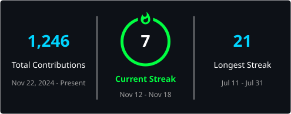

 

### `// FEATURED WORK`

Tiles open the repo · BuildMate opens the live app → [repo](https://github.com/N-AVTEJ/BuildMate) · [all repositories](https://github.com/N-AVTEJ?tab=repositories)

  

### `// ACTIVITY`

 

