<div align="center">


</div>

<br/>

```bash
$ whoami --verbose

Name       : Navtej Madipadiga
Role       : Full Stack Developer & AI Product Builder
College    : Aurora University, Hyderabad · B.Tech CS (Class of 2028)
Internship : ElevanceSkills — UI/UX, frontend, backend → shipped DevLens AI
Focus      : Production-grade AI products, built solo, end to end
Status     : Open to internships & collaborations
```

## 💡 About

I design and ship **full-stack products with AI in the core** — not bolted on. Recent work: a Next.js career-intelligence platform on Gemini, a marketplace with server-verified Razorpay payments, a privacy-first period tracker for India, and a phone-as-a-bat cricket game driven by real motion sensors.

- 🧠 Building with **Gemini** & **Claude** APIs — RAG pipelines, agentic flows, structured generation
- ⚙️ Full stack: React / Next.js / React Native → Flask / Node → normalized SQL schemas
- 🔐 Security-minded: backend-authoritative payments, role-based access, encrypted local storage
- 🏆 4 hackathons · 2nd place at AVISHKRUTI (50+ teams)
- 🔨 Building now: **PromptForge** (prompt engineering academy), **DevLens v2**, **VelvetCycle** smart-health features

---

<div align="center">

## 🚀 Featured Work

<a href="https://github.com/N-AVTEJ/devlens_git"></a>
<a href="https://build-mate-phi.vercel.app"></a>
<a href="https://github.com/N-AVTEJ/BAT-sense"></a>
<a href="https://github.com/N-AVTEJ/VelvetCycle_tracker_app"></a>
<a href="https://github.com/N-AVTEJ/AutoDoc-ai-ForDevlopers"></a>
<a href="https://github.com/N-AVTEJ/apex-moto-speedo"></a>

<sub>Tiles open the repo · BuildMate opens the live app → [repo](https://github.com/N-AVTEJ/BuildMate)</sub>

</div>

### 📦 More Builds

| Project | What it does | Stack |
|:---|:---|:---|
| 💊 [Pharmacy Protect](https://github.com/N-AVTEJ/pharmacy_protect) | Pharmacy management: customer + admin portals, billing automated by DB triggers, 3NF schema, stored procedures and views | Flask · MySQL · Bootstrap 5 |
| 🎬 [Movie Recommender](https://github.com/N-AVTEJ/Movie_recommendation_system) | Collaborative filtering + content-based similarity scoring | Python · Scikit-learn · Pandas · Streamlit |
| 🔐 [Secure Password Manager](https://github.com/N-AVTEJ/Java_Secure-Intelligent-Password-Manager) | Encrypted credential vault with intelligent password generation | Java · Encryption · OOP |
| 🎓 RankToCollege | Free college finder for Telangana/AP students (MPC, BiPC, CEC, MEC) with cutoff-based admission prediction | React |
| 🧪 PromptForge *(in progress)* | Interactive prompt engineering academy: 10 modules, live AI labs, video lessons | React |

<div align="center">

[→ See all repositories](https://github.com/N-AVTEJ?tab=repositories)

</div>

---

## 💻 Technologies & Tools

<div align="center">


</div>

| Layer | Tools |
|:---|:---|
| 🎨 **Frontend** | Next.js · React · React Native / Expo · TypeScript · Tailwind CSS · Three.js · GSAP |
| ⚙️ **Backend** | Node.js · Express · Flask |
| 🤖 **AI/ML** | Gemini API · Claude API · Scikit-learn · TensorFlow |
| 🗄️ **Data** | PostgreSQL · MySQL · MongoDB · Supabase |
| 🚀 **DevOps** | Docker · Git · GitHub Actions · Vercel |
| 💳 **Payments** | Razorpay Standard Checkout (HMAC-verified) |

---

## 🏆 Achievements

| Year | Result |
|:---:|:---|
| 🥈 2025 | **2nd Place** — AVISHKRUTI Build-a-Thon (50+ teams) |
| 🏆 2025 | **Top 1000** — Vibe Hacks (HackWithIndia) |
| 🎯 2025 | **Finalist** — IIT Hyderabad Hackathon |
| 🎯 2025 | **Finalist** — IIT Madras Hackathon |

---

## 📊 GitHub Analytics

<div align="center">


<!-- Re-enable after adding PAT_1 to your Vercel stats instance (rate-limit fix):


-->

</div>

---

<div align="center">

## 🌐 Let's Connect

<a href="mailto:madipadiganavtej@gmail.com"></a>

</div>
